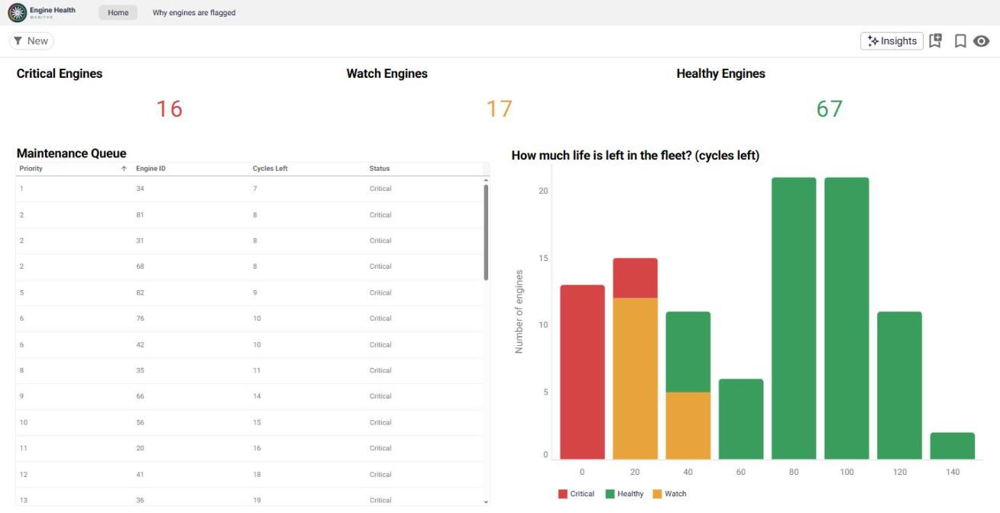
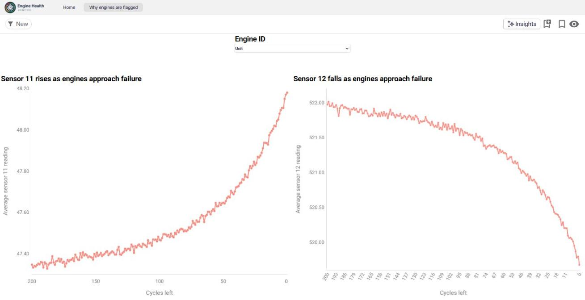

<p align="center">
  
</p>

# Engine Health Monitor: which engines need maintenance first?

An end-to-end predictive-maintenance project using NASA's turbofan engine data. I cleaned and analysed the data in Python, loaded it into **Google BigQuery**, and built an interactive **Astrato** dashboard. The dashboard shows a maintenance planner which engines need attention first, and why.

> **Status: in progress.** The analysis, BigQuery tables and two-page dashboard are built. Still to come: a public dashboard link, a machine-learning model to predict remaining life, and write-back actions. The screenshots below show the dashboard as it is now.

**[Live dashboard on Astrato](https://app.astrato.io/embed/pCjZMbC)** (public access is still being set up, so the link may ask you to sign in for now)



## The problem

Aircraft engines wear down gradually. If maintenance happens too late, an engine can fail; if it happens too early, money and engine life are wasted. The aim is to know **how many cycles each engine has left (its remaining useful life, or RUL)** so that maintenance can be planned at the right time.

## Key results

- **Fleet status today:** of 100 engines, **16 are Critical** (20 cycles or fewer left), **17 need watching** (21–50 cycles) and **67 are Healthy**.
- **Most urgent:** engine 34 has only 7 cycles left, followed by engines 31, 81 and 68 with 8 cycles each.
- **Engine lifetimes vary widely**, from 128 to 362 cycles (average 206). That's why maintenance can't simply be scheduled after a fixed number of cycles.
- **7 of the 21 sensors (and all 3 operational settings) barely change**, so I removed them. That left 14 useful sensors.
- **The strongest wear signals** come from sensors s11 (correlation with RUL −0.70), s4 (−0.68), s12 (+0.67) and s7 (+0.66). They are fairly stable for most of an engine's life, then **change sharply in the last ~50 cycles**. This fits the fault being simulated: high-pressure compressor degradation.



## How it works

```
NASA C-MAPSS text files (zip)
        │  Python: pandas, NumPy, Matplotlib (engine_health.ipynb)
        ▼
Clean data: RUL calculated, flat sensors removed, Healthy/Watch/Critical status
        │  CSV export
        ▼
Google BigQuery: engine_history and fleet_snapshot tables + views (sql/bigquery_setup.sql)
        │  Astrato semantic layer (live connection)
        ▼
Astrato dashboard: fleet overview + "why engines are flagged" sensor trends
```

### The dashboard

**Page 1, Fleet overview**
- Headline counts of Critical, Watch and Healthy engines
- A maintenance queue ranking every Critical and Watch engine by cycles left
- A chart of how much life is left across the fleet, in 20-cycle groups, coloured by status

**Page 2, Why engines are flagged**
- Average sensor 11 and sensor 12 readings plotted against cycles left, showing the readings changing sharply as engines approach failure
- An engine selector to look at a single engine

## Notebook walkthrough

[`engine_health.ipynb`](engine_health.ipynb) is split into short steps, each followed by a "Key insights" note:

1. Import the data straight from the zip
2. Check for missing values and engine lifetimes
3. Calculate remaining useful life (RUL) and check it
4. Remove sensors that don't change
5. Find which sensors track wear
6. Label each reading Healthy, Watch or Critical
7. Build a "today" snapshot of the fleet
8. Export clean CSVs for the dashboard

## Run it yourself

```bash
git clone https://github.com/sc-freelance/engine.git
cd engine
pip install -r requirements.txt
jupyter notebook engine_health.ipynb
```

The notebook reads `data/NASA_CMAPSS_FD001.zip` and writes `data/engine_history.csv` and `data/fleet_snapshot.csv`.

## Repository structure

```
├── engine_health.ipynb        Analysis notebook
├── data/
│   └── NASA_CMAPSS_FD001.zip  NASA data (subset FD001)
├── sql/
│   └── bigquery_setup.sql     BigQuery views used by the dashboard
├── images/                    Dashboard screenshots and logo
├── requirements.txt
└── LICENSE
```

## Limitations and next steps

- **Public dashboard link:** moving the Astrato connection to a read-only BigQuery service account so that anyone can view the dashboard without signing in.
- **The Healthy/Watch/Critical cut-offs (20 and 50 cycles) are my own choice.** In a real airline they would be agreed with maintenance engineers.
- **The fleet's RUL comes from NASA's answer file, not from a prediction.** A natural next step is a machine-learning model, such as a regression on the 14 useful sensors, that predicts RUL from sensor readings alone.
- **Write-back** (for example, a "mark as inspected" button on the maintenance queue) would turn the dashboard into a working tool for a maintenance team.

## Tools

Python (pandas, NumPy, Matplotlib) · Jupyter · SQL · Google BigQuery · Astrato

## Data source

NASA Prognostics Center of Excellence (PCoE) Data Set Repository: Turbofan Engine Degradation Simulation (C-MAPSS), subset FD001.

> A. Saxena, K. Goebel, D. Simon and N. Eklund, "Damage Propagation Modeling for Aircraft Engine Run-to-Failure Simulation", *Proceedings of the 1st International Conference on Prognostics and Health Management (PHM08)*, Denver, CO, October 2008.

The files in `data/` were rebuilt from a Kaggle copy of the dataset and have the same values as NASA's original. Only the number formatting differs (for example 1589.7 vs 1589.70).

## Author

**Saad Chughtai** · [LinkedIn](https://www.linkedin.com/in/saad-chughtai-b77506301) · [GitHub](https://github.com/sc-freelance)
